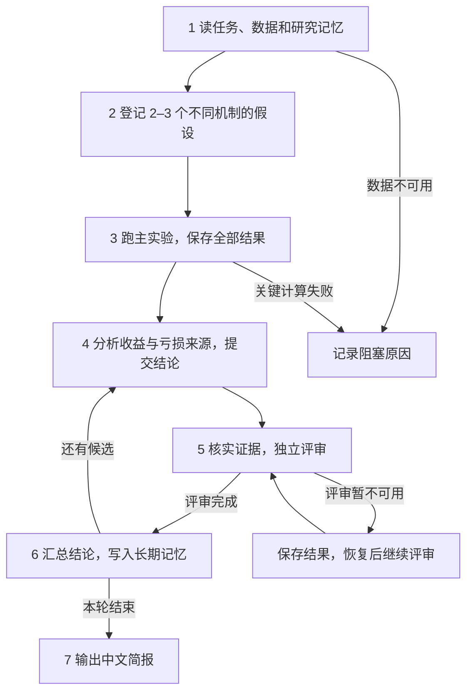

# Aurum 量化因子研究闭环 v0.1

**工程交接稿 · 2026-11-21**

初版在一台电脑上，用一份冻结的 A 股日频数据完成一轮研究。Research Agent 围绕用户的问题提出 **2–3 个来自不同机制的假设**，默认跑两个。Python 做统计和回测，研究员分析收益、亏损和失效原因，Validation Agent 通过 A2A 独立审查，最后将有证据的结论和失败经验写入长期记忆。**每条分支都交付一个答案和一段市场分析。证据不足时，说明现有数据能回答什么、还缺什么。**

## 1. 仓库里已经有什么、还缺什么

| 模块 | 当前 Aurum main | v0.1 要补的内容 |
| --- | --- | --- |
| 聊天与进度 | Next.js 聊天、FastAPI `/chat`、NDJSON 进度、A2A 记录 | 继续用现有入口。增加研究节点、`round_id`、`hypothesis_id` 和失败状态 |
| Research Agent | LangGraph 已有 `context_build_up → intent → research → validate → summarize`。`research` 调用 `mock_research` | 扩展现有图，登记不同机制的假设、运行真实回测、解释收益与亏损来源并写入可查证的结果和研究经验 |
| Validation Agent | 独立服务已有 A2A 和 `assess → enforce_provenance`。当前门槛固定为 `insufficient_evidence`，因为研究输入是合成示例 | 改为先按编号核验证据，再独立审查可解释性、收益与亏损来源、样本偏差和统计强度。既写出认可之处，也说明漏洞 |
| 持久化 | SQLite 已保存会话、消息和黄金快照。Chroma 和缓存用于会话上下文 | 复用 SQLite 增加研究记录。按数据版本、因子家族和实验编号精确查询 |
| 数据和回测 | 小时黄金采集是现货观察。先前的 `factor_api.py` 只有 `ping` 和 `rank_ic`，对传入的逐日因子分数与前瞻收益计算 Rank IC | 接入本地 A 股快照与回放代码，由 Python 生成因子、核对时序并计算收益、成本和诊断 |
| A2A 合约 | Research 向 Validation 发送完整的结构化结果，每次研究一次往返 | 真实研究改传结果编号，评审按编号读取存档并返回独立意见 |

依据 [Aurum README](https://github.com/kuangzil/aurum/blob/main/README.md)、[架构图](https://github.com/kuangzil/aurum/blob/main/docs/architecture.md)、[研究图源码](https://github.com/kuangzil/aurum/blob/main/backend/research_agent/graph.py)、[评审图源码](https://github.com/kuangzil/aurum/blob/main/backend/validation_agent/graph.py) 与 [原 factor_api.py](https://chatgpt.com/library?file_id=libfile_246c2cf4ba708191bf914469d2f3b5ce&account_id=personal)。这是源码与接口核对，仓库服务未运行。

## 2. 最小闭环流程图

Research 图负责阶段和状态。研究员提出并解释假设，评审员独立审查，Python 负责计算、校验和落库。同轮先登记全部候选并运行主实验，按预先定义的检验家族校正，再逐条归因和送审。

| 节点与执行者 | 输入 | 做什么、写什么 | 次状态或停止条件 |
| --- | --- | --- | --- |
| **1 读研究背景** · Python | `session_id`、研究问题、`dataset_id` | 创建 `round_id` 并绑定 `dataset_version`。查询既有因子、失败原因、适用条件和相关实验。会话历史用于理解意图 | 数据或所需列缺失时记入 `blocked` |
| **2 登记假设** · Research Agent + Python | 数据字典、历史结果、用户目标 | 围绕不同机制生成 2–3 份 `factor_spec`。逐条定义代理变量、可能的偏差、预期方向、可证伪条件、执行口径和对照。先写 `factor_hypotheses` 再看结果 | 已登记的规格通过校验，进入 `testing` |
| **3 跑主实验** · Python | 冻结规格、数据版本及实验计划 | 运行候选与对照，记录样本外表现、成本和收益序列。按检验家族统一校正。成功、失败和无有效样本都写入 `factor_experiments` | 区分计算故障与有结论的弱结果。可恢复故障保存阶段状态。个别分支缺样本可带着限制继续 |
| **4 归因并提交** · Research Agent + Python | 已存档主实验、收益和持仓分解 | 每条分支先写收益或亏损来自哪里。表现弱或不稳定时，选最能区分解释的诊断，用 Python 执行并落库。写 `ResearchResult`，附归因证据、尚未排除的解释和暂定结论 | 即使判断未定，也有正式结果和缺证说明可审 |
| **5 独立评审** · Validation Agent + Python | A2A 传 `result_id`，可附关注点 | 查验原始实验、口径及选择性汇报。评审者指出值得认可的发现，也审查代理变量解释、收益与亏损来源、样本偏差、统计强度与可成交性。建议下一步最值得查什么，可写入 `requested_followups` | 评审落库后返回 `review_id`。暂不可用进入 `waiting_review` |
| **6 定案与记忆** · Research Agent + Python | `result_id`、对应的 `review_id` | 回应评审，记录一致结论及分歧。更新假设状态，把有效条件、失效条件、失败路径和标签连同证据 ID 写入 `research_memory` | 转下个候选或结束本轮。待补证的问题保留在记录中 |
| **7 研究简报** · Python 模板 + Research Agent | 本轮假设、全部实验、评审及回应 | 逐条给出答案、市场分析、收益或亏损来源、置信程度、证据编号和仍待回答的问题。数字从原始记录读取 | 输出 `round_id` 和本轮状态，待评审时也可展示中间结果 |

**评审后的补充实验可选。** 评审可以指出哪个缺口最可能改变当前判断。初版可将建议写进报告或下一轮待办，自动重跑和二次评审可以之后接入。后续若重跑，新增实验和结果版本，并保留原稿与原评审。同一批已用于调整规则的数据只提供探索性证据。确认性结论使用规则冻结后、未参与选择的数据。时间对齐错误等计算故障按无效实验处理，修复后重跑原规格。

## 3. 状态与读写权限

图里只携带少量定位信息，例如 `round_id`、`current_hypothesis_id`、`result_id`、`review_id`。重启所需状态和证据保存在现有 SQLite。业务记录可以沿用原先五张表，另加一张轻量的轮次表。版本化规格、数据清单和完整结果可先用 JSON 字段或只读本地清单保存。

| 表 | 初版应记录的字段 | 写入者 |
| --- | --- | --- |
| `research_runs` | `round_id`、`session_id`、`dataset_version`、`state`、`next_node`、`current_hypothesis_id`、`error_code`。可选 `request_id` 用于重试去重 | Research 侧编排代码 |
| `factor_hypotheses` | `hypothesis_id`、`round_id`、`parent_hypothesis_id`、`mechanism`、`rationale`、`factor_spec_json`、`spec_version`、`status`、`evidence_summary` | Research 侧编排代码 |
| `factor_experiments` | `experiment_id`、`run_key`、`hypothesis_id`、`action`、`spec_version`、`dataset_version`、`engine_version`、`params_json`、`result_json`、`execution_status`、`error_code`、`run_at` | Research 侧 Python，结案记录只追加 |
| `research_results` | `result_id`、`supersedes_result_id`、`hypothesis_id`、`evidence_experiment_ids`、`claims_json`、`exploration_path`、`proposed_verdict`、`pnl_attribution`、`attribution_status`、`attribution_detail`、`caveats` | Research 侧结果仓库 |
| `validation_reviews` | `review_id`、`result_id`、`provenance_check`、`unsupported_claims`、`strengths`、`critiques`、`statistical_assessment`、`attribution_agreement`、`suggested_verdict`、`requested_followups` | Validation 侧评审仓库 |
| `research_memory` | `memory_id`、`type`、`topic`、`lesson`、`evidence_experiment_ids`、`review_id`、`confidence` | Research 侧记忆仓库 |

- **轮次状态**可用 `queued`、`running`、`waiting_review`、`blocked`、`completed`。假设状态沿用 `proposed`、`testing`、`validated`、`rejected`、`needs_more_data`、`decayed`。运行失败进 `blocked`，待评审的假设保留 `testing`，有了证据但研究结论不充分才判 `needs_more_data`。
- **A2A 发的是引用。** 请求形如 `{"result_id":"R-…","hypothesis_id":"H-…","focus":"重点审查执行延迟"}`。同机两服务使用同一 SQLite 文件，通过限定方法读取正式结果和实验。评审侧唯一写入口是 `validation_reviews`。Research 侧读回存档做定案。跨机器共享证据的方式留到实际部署时定。
- **重试沿用业务编号。** 按 `round_id + hypothesis_id + spec_version + action + 预登记参数` 生成 `run_key`，先查已完成结果再运行。执行失败另追加尝试记录，同一 `run_key` 只允许一条成功证据。评审按唯一 `result_id` 去重，重复请求返回已写入的评审。新版本的 `result_id` 有独立 `review_id`。同时写入阶段结果与下一节点，避免重启后丢进度。
- **每项可量化主张都有指标路径。** `claims_json` 中引用 `experiment_id` 与 `metric_path`（例如 `/oos/rank_ic/mean`）以及必要的切分或对照。展示数字由 Python 从 `result_json` 读取。比较性的断言同时引用两侧证据。评审还按 `hypothesis_id` 查完整记录，抓被遗漏的失败尝试和无法复现的设置。
- **证据门槛由代码执行。** 关键来源缺失、数字对不上、口径不符或只有合成输入时，结果不能升为 `validated`。次要引证缺失可标 `partial`，撤回该断言或补证后，再按其余证据决定。评审给 `accept`、`accept_with_caveats`、`needs_more_evidence` 或 `reject`，研究员记录最终判断和分歧。HAC t、IC、Sharpe 等值都作为权衡的依据，结案报告说明采纳或保留的理由。

## 4. 量化节点实际要算什么

使用 **一份冻结的数据快照 + 一个确定性的 Python 回测入口**。初版可以用 `run_experiment(action, spec, dataset_version, overrides)` 在 Research 服务内部调用。数据清单至少记录原始来源、文件校验值、字段单位、交易日历、覆盖范围及资产池版本。所有诊断继承同一套规格，只覆盖对应实验明确声明的参数。

| 优先级 | Python 动作 | 输出与研究判断 |
| --- | --- | --- |
| 必须 | `list_datasets`、`evaluate_factor` | 读取登记的本地快照。输出训练及样本外 Rank IC、普通 t、HAC t/p/滞后阶数、一阶自相关、有效日期数与截面覆盖，以及只做多扣费收益、同池基准、换手和回撤。保留分层收益与逐期基准差。可用时增加核心持仓的贡献、成本和交易受限情况，帮助定位收益或亏损来源 |
| 必须 | `walk_forward`、`multiple_testing` | 首版固定规则做滚动样本外切分，记录每折的日期与 IC，调参或拟合只在当时的训练窗口内。按事先定义的检验家族校正主检验 p 值，保留所有被用于挑选的方向、窗口与候选及遗漏原因 |
| 按问题触发 | `regime_breakdown`、`lag_decay`、`capacity_proxy` | 用分年、预先定义的趋势或波动状态定位表现变化。以同口径改变执行延迟。用成本网格、换手和流动性代理量看可实现性 |
| 有合适对照时 | `correlation` 或简单匹配对照 | 已有因子库时，查与基线的相关性。想验证独立 alpha 时，加入同市值或同流动性对照，评估扣费后的增量。相关性本身只能描述重合度 |
| 有数据再启用 | `combine_factors`、衰减复核 | 至少三个已有复验证据且时间对齐的因子，再用同一时期、同成本比较滚动组合与静态等权。组合只用当时已实现的 IC/ICIR。初版在研究结案时记录组合状态。衰减先支持手动触发复测 |

- **信号可用性与交易时点。** 规格写清信号在哪个时点可用、执行价格、多少交易日后成交、持有期、调仓步长、停牌/涨跌停/缺报价的处理，以及收益标签的首尾。训练标签跨入验证区间的样本剔除。特征、资格和状态只用当时时点可得的信息。涉及事后构建股票池或数据商修订时，报告明确记录偏差。因子先用登记的预计算列或受控算子表达，由 Python 拒绝未知列和算子。
- **统计口径。** 对同一条逐调仓日 Rank IC 序列计算普通与 HAC/Newey–West t，报告两者实际差异。滞后单位是序列采样步，按实际标签重叠和依赖预先设定。缺测时保留交易日位置并记录处理办法。截面股票行数与有效 IC 日期数分开。首版主检验可用 Bonferroni。以同一数据版本、观察窗和目标下实际参与筛选的主假设定义家族，留存校正成员。重复跑同一规格不新增主检验，实际用于选择的变体要计入。 [HAC 计算说明](https://www.statsmodels.org/dev/generated/statsmodels.stats.sandwich_covariance.cov_hac.html) · [多重检验说明](https://www.statsmodels.org/stable/generated/statsmodels.stats.multitest.multipletests.html)
- **失败归因是研究员在送审前的产出。** 对弱结果或明显不稳定的结果，先定位亏损集中在哪些日期、股票或分组，然后挑能区分解释的诊断。每个原因写证据 ID、推断强度以及仍有哪些解释未排除。多个原因可给主次，证据无法区分时写 `attribution_status=unresolved`。评审给 `agree`、`partly_agree` 或 `disagree`，并说明为什么。

| 可能的原因 | 首版可以查什么 | 能得出什么结论 |
| --- | --- | --- |
| 市场风格 `regime` | 按事前可识别的趋势、波动或大小盘相对强弱分组，查同池超额收益与 IC | 效果集中在哪些状态。用事后观察到的亏损窗口只能做诊断 |
| 不利信息 `adverse_information` | 找亏损贡献最高的日期或持仓，核对当时可追溯的公告或冲击及对照 | 事件解释是否有证据支持。只有日期重合时标为推测 |
| 执行滞后 `lag_decay` | 同一信号在多个可成交延迟下比较 IC 与扣费表现 | 优势是否随可辩护的执行延迟消失 |
| 拥挤或容量 `crowding` | 看成本压力、换手、成交额或持仓相关性 | 可判断对交易摩擦有多敏感。缺资金流或持仓证据时，拥挤只作为可能解释 |
| 原假设不成立 `hypothesis_wrong` | 复查代理变量和反事实对照，排除当前数据能检验的主要替代解释 | 说明原假设在哪个适用范围内未获支持。检验覆盖不足时保留未决 |
- **研究过程与长期记忆可复查。** 每条分支记录「想检验什么 → 为什么这个变量能代理该机制 → 代理偏差可能怎样改变结果 → 怎样看出假设成立或失败 → 实验发现 → 替代解释 → 是否保留及原因」。保留尝试过的路径和选择理由，引用 `experiment_id` 和 `review_id`。记忆区分经验、放弃的路径、数据问题和待研究想法，下一轮用标签查回适用条件和证据。当某项检验缺字段、未实现或没有有效样本时，标注原因。组合、跨市场与模型重要性可以按实际需要再实现。

AlphaForge 的生成、筛选与动态组合可提供后续思路。首版借鉴「候选要有差异」和「挖掘与组合可拆开」，由 Research Agent 提出有经济含义的机制，并用本地实验判断。 [AlphaForge 知乎解读](https://zhuanlan.zhihu.com/p/711179859)

## 5. 第一轮演示用什么

**先回放低成交额账户，校准引擎。再用两条不同机制的候选演示研究。** 回放输入用原研究的 `cache_daily49`。账本已归档，适合做逐日一致性验收。它的历史曾用于研究，回放结果只能用于校准或归入探索性证据。

| 用途 | 冻结的思路 | 这轮会回答什么 |
| --- | --- | --- |
| 引擎校准，不计入发现的新因子 | 按原规则每 5 个交易日调仓，成交额分数为过去 21 日均成交额取对数后取负，使用原买入/保留缓冲、涨跌停与成交规则，并和同池等权逐日核对 | 同一数据和同一成交规则能否复算原账本 |
| 候选 A · 流动性 | 在可获得并通过审计的规模分组内，比较低成交额与同规模对照。同一资产池、时钟和成本。先登记原始及分组口径 | 低成交额的表现有多少可能由规模暴露解释。规模代理不可靠时结论可到什么程度 |
| 候选 B · 价格延续 | 用已有 `f_mom6_1`（`close[t-21]/close[t-126]-1`）按高分排序。同池同成本，主检验固定持有期 | 中期延续是否在固定切分中有预测力，在哪些年份更不稳定。与流动性信号是否有增量关系 |

数据根目录为 `D:\Quant 学习\A股分钟级别数据`，原回放输入在下属 `因子扩展与回测_20261106\cache_daily49`。队友可用本机配置指向同版本快照。路径和原数据都留在各自本机。原策略的详细资格、成本和账本链接见 [A 股广池五日低成交额策略研究交接](https://chatgpt.com/library?file_id=libfile_d248b331efc48191ba8f093bea99e1b7&account_id=personal)。

## 6. 队友可以怎样拆实现任务

| 实现任务 | 建议落点 | 完成条件 |
| --- | --- | --- |
| **A · 数据与回测** | 新增本地数据适配器和回测模块。复用原账户回放逻辑与 `factor_api.py` 的 Rank IC 算法 | 固定快照和配置重复运行得到同样指标。逐日对账。人为构造的跨窗口标签被拦截 |
| **B · 状态与证据** | `backend/storage/` 新增研究仓库，沿用 SQLite。用 Pydantic 定义规格、提交稿与评审 | 能从 `result_id` 重建证据。存档包含失败/无样本。中断后能继续，重复交付不重复写成功记录 |
| **C · 编排与评审** | 修改两套 `graph.py` 与 schema，扩展 `backend/a2a_transport/`。沿用 `/chat` 与 NDJSON | 默认两条分支能跑完，第三条可按需求登记。评审能引用值得认可的发现、指出证据缺口，也能在评审服务恢复后继续已有稿件 |
| **D · 简报与验收** | 复用 `summarize` 和现有聊天页面。输出中文报告和可追踪的引用 | 用一条有支持的结果和一条弱结果演示全流程。报告各自给出答案、市场分析和有证据的归因，暂不能区分的原因保留未决。下一轮能通过标签找回失败记录 |

先用确定性模型输出与小样本接通全部节点，再用真实本地快照确认回放。初版保留两个已有 Python 服务和同步 A2A。若全量回测跑不进现有 `/chat` 时限，先由本地 CLI 完成同一流程，聊天端展示已落库的结果。分布式任务、调度与新前端可随实际运行需求排期。
