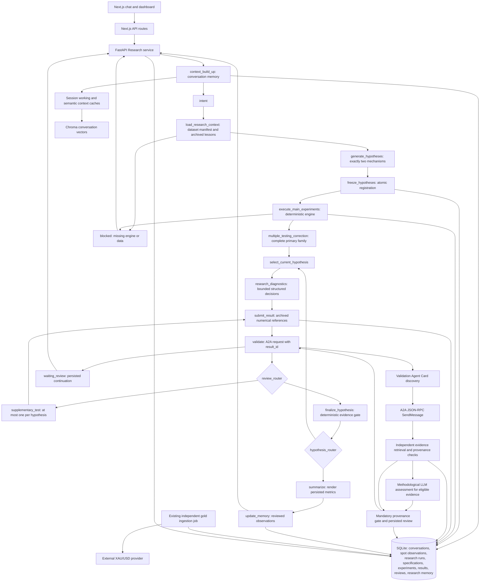

# Aurum architecture

The existing two Python services and LangGraph orchestration remain. A2A is a non-streaming request/response exchange per review; the browser's NDJSON progress stream is separate. Both services use the same local SQLite file for independent evidence retrieval. Repository API separation is not database-level permission isolation.

The quantitative contributor implements the `QuantEngine` boundary. No engine is registered in production yet: research records an explicit blocked state. Test-only engines are never imported by production modules. See [the integration contract](./quantitative-workflow.md).

Frozen specifications precede experiments, and both registered primary sequences precede multiple-testing correction and review. Python, not the model, enforces execution order, numerical evidence references, diagnostic budget and supplementary allowance. Failed and insufficient-sample records remain archived. Models cannot turn mandatory provenance failures into accepted research.

Conversation memory retains its existing session-scoped SQLite, working-memory, semantic-cache and Chroma behavior. It supplies unverified context for interpreting requests. Research memory is separate, uses exact SQLite queries, and stores evidence/review references. Market observations remain separate from empirical strategy evidence; the collector, provider and market endpoints are unchanged.

Workflow state and continuation nodes are durable. Explicit resume can continue a waiting review or an acknowledged failed run. There are no automatic retries, distributed queues, additional agents or new services. The existing frontend receives truthful workflow status and the archived report; no dashboard redesign is involved.
