# Aurum architecture

```mermaid
flowchart LR
    subgraph Browser["Browser"]
        User["User"]
        UI["Next.js UI<br/>ChatInterface"]
        Local["localStorage<br/>sessions, messages, UI history"]
        User --> UI
        UI <--> Local
    end

    subgraph Web["Next.js server"]
        Proxy["POST /api/chat<br/>validate and proxy request"]
    end

    subgraph ResearchService["Python Research API · :8000"]
        API["FastAPI<br/>POST /chat"]
        subgraph ResearchGraph["Research Agent · LangGraph nodes"]
            RStart(["START"])
            Context["context_build_up<br/>Session cache → Chroma RAG<br/>+ bounded recent history"]
            Intent["intent<br/>Plan objective, tasks,<br/>hypothesis, methodology"]
            Research["research<br/>Build synthetic ResearchResult"]
            Validate["validate<br/>Call ValidationClient over A2A"]
            Summarize["summarize<br/>Combine research + review<br/>into final reply"]
            REnd(["END"])
            RStart --> Context --> Intent --> Research --> Validate
            Validate -->|"ValidationResult or unavailable"| Summarize --> REnd
        end
        API --> RStart
    end

    subgraph ValidationService["Python Validation Agent · :8001"]
        Card["Agent Card<br/>/.well-known/agent-card.json"]
        RPC["A2A JSON-RPC<br/>/a2a/jsonrpc"]
        subgraph ValidationFlow["Validation Agent · request handling + LangGraph nodes"]
            VStart(["A2A request"])
            Parse["AgentExecutor<br/>Check role and parse ResearchResult"]
            Assess["assess<br/>Review clarity, evidence,<br/>logic, missing tests"]
            Provenance["enforce_provenance<br/>Force insufficient_evidence<br/>for synthetic data"]
            Respond["Return ValidationResult<br/>in A2A Message"]
            VStart --> Parse --> Assess --> Provenance --> Respond
        end
        RPC --> VStart
    end

    LLM["Optional OpenAI-compatible LLM"]
    SQLite[("SQLite<br/>sessions + messages<br/>gold_price_snapshots")]
    Chroma[("Persistent Chroma<br/>conversation embeddings")]
    Cache["Process-local semantic cache<br/>session + revision + LRU"]
    GoldJob["Hourly external scheduler<br/>CLI or token-protected POST"]
    GoldAPI["api.gold-api.com/price/XAU<br/>External USD/troy-ounce spot quote"]

    API -->|"Persist new user and successful assistant messages"| SQLite
    Context <--> Cache
    Context -->|"Cache miss: session-filtered search"| Chroma
    Context -->|"Authoritative text + latest market observation"| SQLite
    SQLite -->|"Retryable stable-ID indexing"| Chroma
    GoldJob --> GoldAPI
    GoldJob -->|"Immutable UTC hourly observation"| SQLite

    UI -->|"session_id + message"| Proxy
    Proxy -->|"POST /chat<br/>session_id + message"| API
    Intent -. "planning (openai mode)" .-> LLM
    Assess -. "assessment (openai mode)" .-> LLM
    Validate -->|"Discover Agent Card"| Card
    Validate -->|"A2A SendMessage<br/>ResearchResult in Part.data"| RPC
    Respond -->|"A2A Message<br/>ValidationResult in Part.data"| Validate
    Summarize -->|"ChatResponse<br/>reply, results, trace"| API
    API -->|"JSON or NDJSON progress + result"| Proxy
    Proxy --> UI
```

## Notes

- Each backend chat request runs a fresh research workflow preceded by `context_build_up`. The backend retrieves only records from the requested session and treats previous statements as unverified conversation context.
- The browser retains sessions and messages in `localStorage`. The frontend helper and Next.js proxy send only the new `session_id` and `message`; historical browser data is not imported.
- SQLite is authoritative for received messages. Persistent Chroma stores explicit local-model embeddings linked by message UUID. Failed vector writes remain retryable without losing raw messages.
- The application semantic cache is not an LLM KV cache. Cache hits skip Chroma search but still run all research and validation nodes; LRU and session revisions limit stale context. SQLite rechecks ownership even for cached IDs.
- Current-price questions bypass conversation context. Market observations are read separately on every run and expose quote/fetch timestamps and dynamic freshness. External prices never change synthetic research provenance.
- Hourly collection runs independently of FastAPI worker lifecycles. The CLI and token-protected `POST /internal/jobs/sync-gold-price` share one service; `GET /market/gold/latest` and `/market/gold/history` expose durable observations. A stopped host cannot collect missed hours.
- A2A is a single non-streaming request/response exchange. The browser-facing NDJSON progress stream is a separate API feature.
- The Research Agent sends one structured `ResearchResult` to the validator. The validator responds with one structured `ValidationResult`; it enforces `insufficient_evidence` because this implementation's research evidence is synthetic.
- The validator's `InMemoryTaskStore` is process-local task storage, not shared or durable agent memory. The two agents do not share graph state.
- In mock mode, planning and assessment use deterministic local behavior. In OpenAI mode, the corresponding planning and assessment steps may call the configured OpenAI-compatible LLM.
